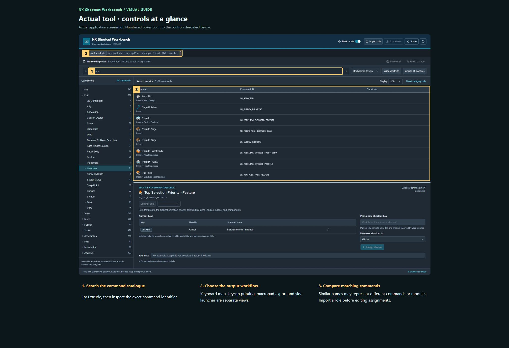
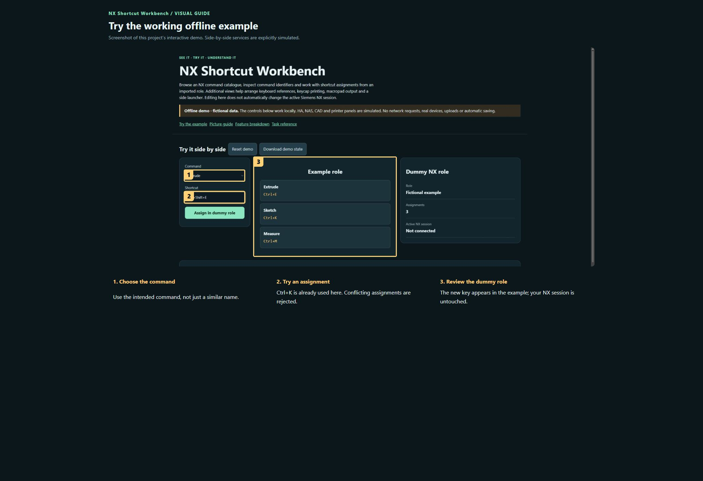

# NX Shortcut Workbench

**Maintaining this project? [Start here](docs/START-HERE.md) · [Detailed handover](docs/HANDOVER.md)**

Browse an NX command catalogue, inspect command identifiers and work with shortcut assignments from an imported role. Additional views help arrange keyboard references, keycap printing, macropad output and a side launcher. Editing here does not automatically change the active Siemens NX session.

**Private preview · not published.**

[Open the visual manual](docs/USER-MANUAL.md) · [Download the self-contained demo](demo.html) · [Release notes](CHANGELOG.md)

Download `demo.html` using GitHub’s Download raw file control, then open it in your browser. GitHub displays HTML source; it does not run the demo on this page. The demo is an offline simulation with fictional data and makes no network requests.

## See it

### Actual tool · controls at a glance

Actual application screenshot. Numbered boxes point to the controls described below.

1. **Search the command catalogue.** Try Extrude, then inspect the exact command identifier.
2. **Choose the output workflow.** Keyboard map, keycap printing, macropad export and side launcher are separate views.
3. **Compare matching commands.** Similar names may represent different commands or modules. Import a role before editing assignments.

### Try the working offline example

Screenshot of this project’s interactive demo. Side-by-side services are explicitly simulated.

1. **Choose the command.** Use the intended command, not just a similar name.
2. **Try an assignment.** Ctrl+K is already used here. Conflicting assignments are rejected.
3. **Review the dummy role.** The new key appears in the example; your NX session is untouched.

## What this tool does

| Feature | What it lets you do | Where |
| --- | --- | --- |
| Search and categories | Find commands, filter by installed-module grouping and show assignments or UI controls. | Workbench views |
| Role import/export | Import an .mtx role before editing assignments; export the resulting role for NX. | Workbench views |
| Draft and undo | Save an editing draft and undo changes in the workbench. | Workbench views |
| Keyboard Map | Review assignments spatially on a keyboard. | Workbench views |
| Keycap Print and Macropad Export | Prepare reference/key-label output and supported macro-pad data. | Workbench views |
| Side Launcher and help | Review launcher options and the documented catalogue sources. | Workbench views |

## A first useful workflow

### Find a command

1. Type a name such as Extrude into Search all commands. Review both the displayed label and command identifier: similarly named commands can belong to different workflows.
2. Use category and installed-module filters to narrow results. Include UI controls only when you intend to inspect those entries too.
3. Open a command’s details before assigning it. Catalogue presence does not prove that your NX installation licences that command.

## Saving and outputs

Keep the original .mtx, the edited export and any workbench draft separately. Browser drafts can disappear when site data is cleared. Role files and macro-pad exports are different deliverables.

## Running the actual tool

Open external-sources/StandaloneTools/NX-Shortcut-Workbench.html.

The demo has no prerequisites; the real tool may need the services described in the manual and retained source notes.

## Current boundaries

The included catalogue references NX 2412. Other versions/modules and macro hardware need testing. Siemens catalogue/icon assets require rights review before public distribution; the repository remains private.

## Licence and sharing

MIT applies to original project contributions. Bundled/upstream software and assets retain their own terms; see [third-party notes](THIRD-PARTY.md). Keep this repository private until its own [release checklist](RELEASE-CHECKLIST.md) is complete and the owner authorises publication.
